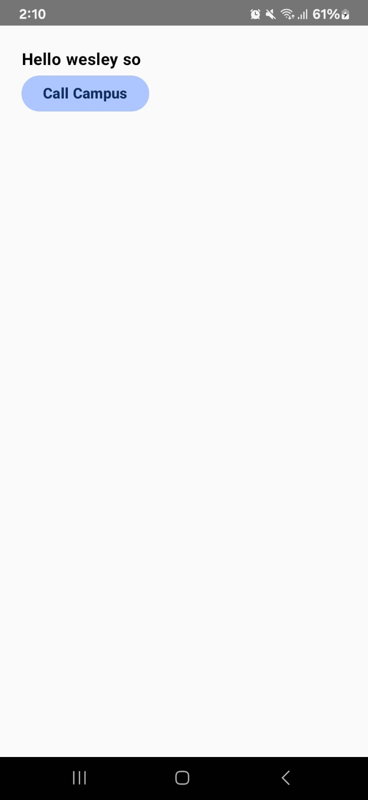
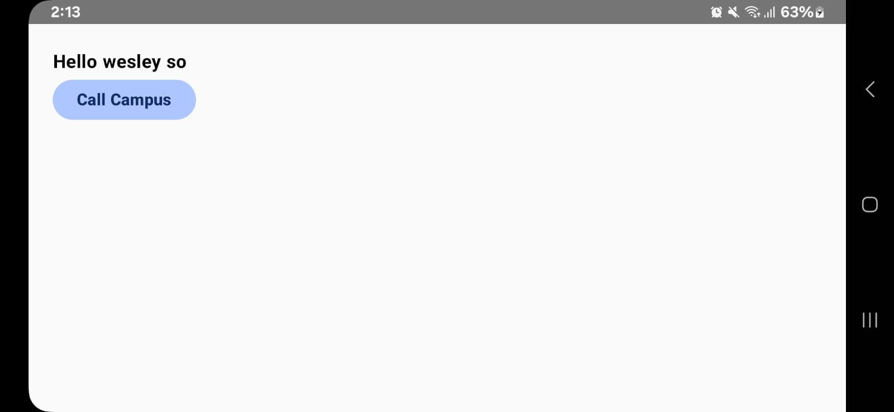
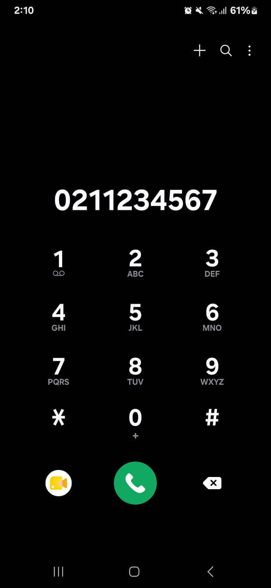
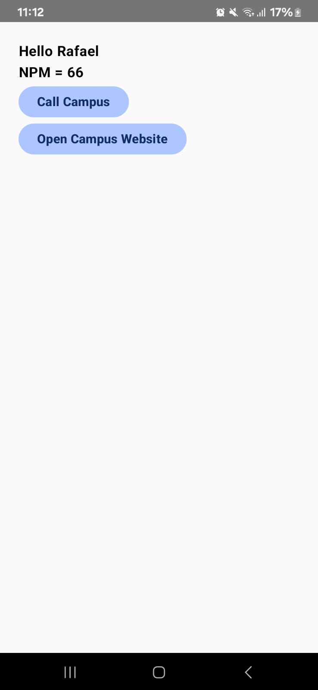
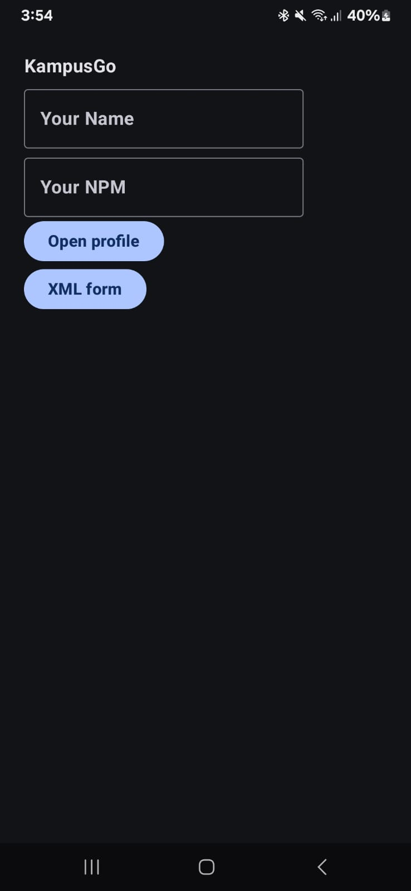
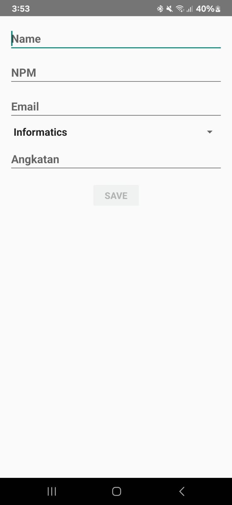
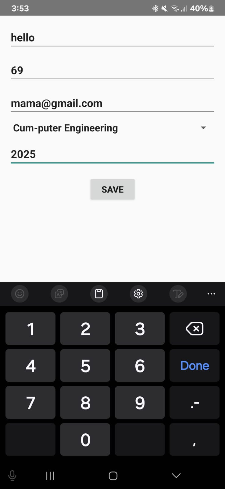
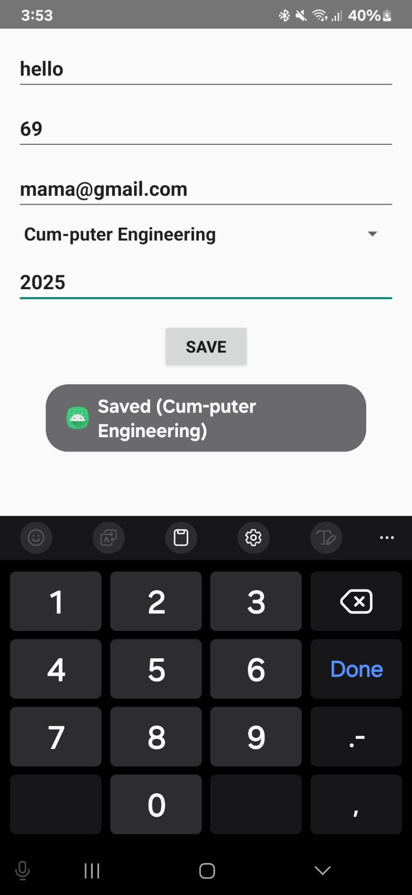

# KampusGo Assignment Week 3
## Desk check (end of lab)
### Portrait Shot:

### Landscape Shot:

### Dialer Opened:

## Assignment 1
Check out the code for ProfileActivity in `app/src/main/java/com/sgu/kampusgo`

### Result:

# KampusGo Assignment Week 4
## Desk check (end of lab)

